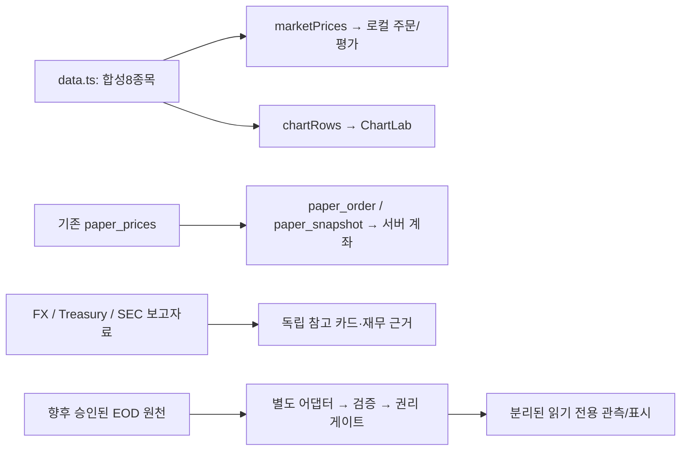

# v0.9-A1 · 미국 주식 EOD 공급자 재검증과 읽기 전용 기술 계약

확인일 **2026-11-04 UTC**. 기준 main `a49915ada0624b22234b0c5c84e64352c9e9d047`, 실제 앱 배포 `4a1e9f7c74254ea58b6fb61d6f90f1277f4791fa`, 개발 브랜치 `codex/v09-a1-eod-contract`. 원격 main·부모·기존 checkout의 clean 상태와 신규 브랜치 부재를 확인한 뒤 기준 main에서 분기했다.

**판정: 친구 3~4인 비공개 파일럿과 공개 Pages의 실제 EOD 값 표시는 모두 NO-GO.** 무료 API 접근은 타인 표시·브라우저 전달·저장·재배포 승인이 아니다. A2는 별도 요청으로 **가상 fixture 기반 계약/정규화/정책 검증만** 진행할 수 있다. 공급자 확정·실제 키 발급/호출·유료 결제·운영 캐시/DB·UI 연결은 이번에 하지 않는다.

이 문서는 [v0.5 연구](V0_5_A_PROVIDER_RESEARCH_AND_DESIGN_20261027.md)의 금융 격리 원칙을 유지하되, 공급자 현재 문구·종가 의미·권리 만료·정밀도/시간 계약을 구체화한다. 과거 제안의 Supabase Edge/Cron/테이블은 **설계 후보**일 뿐 승인된 배포나 구현으로 승격하지 않는다. 현재 운영 경계는 [v0.8 최종 기록](../release/V0_8_FINAL.md)과 [인수인계](../handoff/US_STOCK_LAB_V08_TO_V09.md)를 따른다.

## 1. 현재 코드·데이터 흐름 감사

### 1.1 실제 의존 경계

| 파일/경로 | 현재 역할 | EOD와의 경계 |
| --- | --- | --- |
| `src/data.ts` | 기존 8종목, `candles()` 결정론적 합성 OHLC, `quote()` 마지막 합성 봉/직전 봉 대비 변화 | 실제 시장 이력이 아니다. `asOf`/캔들 날짜를 수집일로 재라벨링하지 않는다. 이 함수나 배열을 교체하면 안 됨 |
| `src/accountStore.ts` | `marketPrices()`가 quote를 USD 센트로 변환. `executeOrder()`는 잠금/CAS/시장시간 확인 후 이 합성 가격으로 체결. 저장 문서 재생 | EOD를 marketPrices 또는 기존 주문 문서에 주입 금지 |
| `src/serverAccount.ts` | `paper_snapshot` 원장/포지션 재생 검증, 서버 prices 수신. `paper_order`에는 ID/심볼/방향/수량만 전달, 가격 인수 없음 | 외부 관측치를 ServerLoaded/LoadedAccount로 캐스팅하거나 snapshot prices에 합치지 않는다 |
| `src/TradingUI.tsx` | useAccount가 로컬 marketPrices/서버 prices의 소유권 유지. AccountSummary/Portfolio/Simulator는 view.prices, 주문 검토도 해당 가격 사용 | setPrices/accept/refresh/valuation 입력은 EOD 소비자가 아님. 로그인/계정 전환·기존 미확정 주문 복구 불변 |
| `src/StockDetail.tsx`·`src/main.tsx` | 지원8종목 행/합성 가격 배지/4탭, 기존 OrderPanel·조건부 ManualWorkspace. 상세 가격 표시에는 quote 직접 사용 | 실제 EOD 표시를 넣더라도 향후 별도 읽기 전용 영역이어야 함. 기존 synthetic-price/주문 가격·라벨을 교체하지 않음 |
| `src/marketInfo.ts` | 합성6지표와 demo service, 비어 있는 official-pending service. DataStatus는 synthetic/official/pending | 이 모드 전환은 EOD 권리 확인이 아니다. 단순 official=true로 권리·최신성·세션 검사를 우회하지 않음 |
| `src/marketData.ts` | 실제 Frankfurter 혼합 일별 USD/KRW의 별도 FxReference/검증/제한된 함수 주소/10초 요청. 오래된 값은 unavailable | SourceInfo는 observedAtUtc를 필수 string으로 둔다. FX의 날짜→00:00Z 호환 관례를 주식의 실제 관측 시각으로 복제하지 않음. EOD 타입을 별도 정의 |
| `src/MarketPanels.tsx`·`src/treasuryData.ts` | 합성 지표와 실제 FX/재무부 카드를 구분. 실제 카드별 출처/기준일/수집 시각/오류/재조회, 중복 요청 방지/늦은 응답 무시 | 외부 참고자료는 주문·평가로 흘러가지 않음. EOD 추가를 이유로 기존 요청/오류 계약을 바꾸지 않음 |
| `src/companyData.ts`·CompanyDetail | SEC 출처·CIK·보고기간/시점·USD/USD-share·원문 증거·계산 입력 검증, 편집 요약 구분 | 보고 재무수치/219관측은 시장가격이 아님. EOD와 EPS를 임의 결합해 PER/배당률 등을 생성하지 않음 |
| `tests/market-data.spec.ts` | opt-in FX 주소·출처/값/날짜 검증·오류 거부·실제 참고환율과 합성6지표 분리의 기존 fixture | A1에서는 읽기만 했으며 재실행/수정하지 않음. EOD 검증은 추가 별도 fixture 필요 |

직접 의존성으로 `src/uiData.ts`/`marketHours.ts`/`preferences.tsx`/ManualUI의 관련 부분과 기존003 SQL의 price 읽기를 확인했다. chartRows와 SMA/RSI 학습은 합성 캔들 경로다. 기존 주문용 달력은2026~2027의 검토된 범위 밖에서 unknown으로 닫힌다. EOD를 위해 이를 수정/확장하거나 합성 봉의 주말 제외 로직을 실제 거래일 달력으로 사용하지 않는다. KRW 표시는 기존 합성 displayFx에 의존하며 Frankfurter 실제 참고환율로 바꾸지 않는다. 수기 가격/평가는 개발 환경의 사용자 입력이며 외부 시세를 자동 채우지 않는다.



마지막 EOD 가지는 설계이며 현재 구현되지 않았다. 금융 가지로 연결하는 간선/구독/자동 동기화는 두지 않는다. 실제 EOD의 향후 표시는 원문 USD decimal 기준으로 설계하고, 기존 useCurrency.format(센트)에 넣어 합성 FX로 KRW 변환하지 않는다. 표시 통화 선택도 기존 계좌 계산과 분리해 검토한다.

### 1.2 유입 위험과 금지되는 연결

| 잘못된 변경 | 영향 | 이후 검증 조건 |
| --- | --- | --- |
| quote/candles/marketPrices를 공급자 값으로 교체 | 로컬 체결·차트 학습·원가 대비 평가에 실제 가격 혼합 | 해당 원본/합성 출력 불변, EOD 모듈을 금융 엔진에서 import하지 않음 |
| EOD 가격 map을 useAccount.setPrices/accept 또는 decodeSnapshot 결과에 병합 | 검토금액·총자산·추가매수 분석·손익의 가격체계 변경 | 계좌·관심·거래/원장 원본 bytes 및 기존 valuation 동일 |
| 서버 paper_prices 갱신, paper_order/snapshot 계약 수정 | 클라이언트가 가격을 안 보내도 서버 체결가격이 달라짐 | SQL/RPC/price table 변경0, 운영 금융 RPC 추가0 |
| 실제 FX를 displayFx에 넣거나 수기 mark/input을 자동 보충 | KRW 표시/수기 자산의 의미 변경 | 기존 환산·수기 게이트/초안·원장 불변 |
| 티커만으로 EOD·SEC·A5 후보를 연결 | 동명 티커/거래소/클래스/재사용 오류, 거래 범위 확장 | 별도 identity mapping 승인, 후보 tradeEligible=false·주문/관심 편입0 |
| 새 EOD를 기존 Indicator.number/합성 가격 배지에 직접 대입 | 출처/세션/정밀도·권리 판정 소실 | 별도 표시 계약·권리 검사. 결측을 합성 값으로 자동 대체하지 않음 |

## 2. 공급자 재검증: 접근 가능성과 데이터 의미

아래는 공식 문서의 제품/endpoint 능력이며 **우리 계정의 entitlement·8개 실제 응답·정확도 검증은 모두 NOT VERIFIED**다. AAPL/MSFT/NVDA/AMZN/GOOGL와 VOO/QQQ/SCHD를 목표 집합으로 유지한다. 주식/ETF 상품군 지원과 각 심볼·거래소·클래스의 실제 매핑 확인은 별개다. ETF 프로필 상품을 제공한다는 사실만으로 ETF 종가 endpoint/무료 권한까지 확정하지 않는다.

| 공급자 | 주식5/ETF3 문서상 범위와 EOD 경로 | 갱신/정규장·수정 기준 | 키·무료 접근·호출 설계 |
| --- | --- | --- | --- |
| Massive(구 Polygon.io) | 미국 주식·ETF 범위[M1,M2]. 날짜 지정 Daily Ticker Summary `/v1/open-close/{ticker}/{date}`, 이전 거래일 `/v2/aggs/ticker/{ticker}/prev`, 날짜별 grouped daily[M3–M5] | Basic은 과거 ET 날짜를 **ET 자정 이후** 접근; 당일16시 직후에는 아직403일 수 있음[M6]. close와 preMarket/afterHours 분리. adjusted 기본true는 **분할 조정**, 배당 조정 아님[M3,M7]. 일봉/prev의 t는 봉 시작일 수 있어 실제 close 관측 시각으로 사용 불가 | 키 필요. Basic $0,5회/분·2년 이력. 날짜 지정 두 세션이면8종목×2=16요청; 같은 허용 범위의 multi-day 응답이면8. grouped는1일1회지만 전시장 대량 수집이므로 A2 기본 제외. 공유 예산·직렬화 필요 |
| Alpha Vantage | 글로벌 주식/ETF 검색과 DAILY raw 시계열[A1]. `TIME_SERIES_DAILY`의 최근2개 실제 거래일 close를 선택. GLOBAL_QUOTE 요약은 날짜/기준 확인 없이 EOD로 사용하지 않음 | 기본 quote는 거래일 종료 때 갱신한다고 명시하나 완료 분 단위 SLA 없음[A1]. raw DAILY와 premium DAILY_ADJUSTED의 조정 close를 섞지 않음. 후자는 raw OHLC와 분할/배당 조정 close·기업행위 정보를 함께 제공 | 키 필요. 표준25회/일[A2,A3]. DAILY compact100개는무료, full25년+ 및 DAILY_ADJUSTED는 premium[A1]. 8심볼×1회면8요청이나 재시도/다른 사용분도 합산. GLOBAL_QUOTE는1요청1심볼,100심볼 bulk는premium이므로 무료 batch로 간주하지 않음 |
| Twelve Data | 미국 주식/ETF·EOD 지원[T1,T3,T6]. `/time_series` interval1day의2봉, `/quote?eod=true`, 날짜 지정 `/eod` 후보. 개별8심볼의 가격 entitlement/역사 범위는별도 확인 | 미국 이력/EOD는 **다음 거래일 ET 자정 이후** 안내[T3]; 거래소 최종 조정 전 preliminary와 확인 후 값을 구분[T6]. 기본 실시간 feed는거래량 약5%이고 EOD는전시장 집계 설명[T3]. time_series adjust 기본splits, none/all/dividends 지원[T5]. quote의 percent_change는(close−previous_close)/previous_close×100이나 previous는해당bar이므로1day/닫힌세션 검증 필수 | 키 필요. Basic8credits/분·800/일[T1,T7]. batch/multi-symbol도 심볼별 비용이므로8심볼은8credits, HTTP1회가1credit 아님. 출력 소수 dp/endpoint별 adjustment 차이를 고정해 검사 |
| Finnhub | 미국 quote와 유료stock/candle D/W/M, ETF 프로필/보유 상품 문서[F1,F2]. 무료 quote의 pc는previous close, c는current price이므로 무료 quote만으로 날짜 확정 EOD2봉을 보장하지 못함. ETF3종의 candle/거래소 매핑은특히별도 확인 | candle D는분할 조정, intraday는비조정[F2]. candle은**Premium Access Required**. quote d/dp는변화/변화율 필드이나 정규장 EOD 기준·배당 조정·확정 지연은본문만으로 확정 못함. 고정 EOD 제공 시각 SLA 미확인 | 키/token 필요. 공식가격 화면 Free$0·60회/분, 약관에전체30회/초 상한[F1,F3]. 현재 무료 이력 수집 후보로추천하지 않음. quote/candle은심볼별, 무료 EOD batch 권한 근거 없음. 상한까지polling하지 않음 |

표의 숫자·가격은 확인일 공식 표시이며 견적/계약 보장이 아니다. 이번에 가입·키 발급·demo 포함 시세 API 호출·결제는 하지 않았다. Finnhub 가격/문서는 텍스트 reader에서 비어 있어 공개 문서 화면을 렌더링해 확인했다. 시세/API·비문서 XHR/telemetry는 전송 전 차단했고 예제 실행 버튼은 사용하지 않았다. 공식 사이트 헤더의 가격 숫자는 본 문서의 관측치로 취득/사용하지 않았다.

### 2.1 원천 변화율과 역사·기업행위 범위

| 공급자 | 변화율의 제공/정의와 본 계약 적용 | 역사·기업행위 한계 |
| --- | --- | --- |
| Massive | 선택한 open-close/일봉에는 자체 EOD 변화율이 없어 두 종가로 계산. snapshot의 변화율은 latest trade 기준일 수 있으므로 제외[M3,M10] | Basic 조회 깊이는2년. 분할 조정/분할·배당 reference 상품과 실제 plan 접근을 구분; 배당 조정 종가는 현재 제공 안 함[M7] |
| Alpha Vantage | 무료 DAILY는 두 일자의 raw close를 사용. GLOBAL_QUOTE 변화율 필드의 정확한 정밀도/기준은 이번 정적 문서만으로 확정하지 않았고 실제 응답도 미검증이므로 미채택[A1] | 무료 compact100/유료 full25년+; adjusted API의 raw OHLC와 adjusted close 구별. 실제8종목의 최초 거래일/기업행위 이력 누락 여부는 A2/A3 검증 대상 |
| Twelve Data | quote의 percent_change=(close−previous_close)/previous_close×100. 일봉/닫힌 세션·동일 adjustment 확인 전에는 EOD 변화율로 사용 안 함[T5,T10,T11] | 주식/ETF EOD 및 기업행위 설명은 있으나 각 심볼별 실제 깊이와 plan별 splits/dividends 접근은 미검증[T6] |
| Finnhub | quote는 d/dp/pc를 제공하지만 EOD 세션·raw/adjusted 정의가 부족. 유료 candle D의 두 close에서 동일 기준 계산을 검토[F2] | 가격표의 유료 OHLC30년+는 모든8종목의 이력/보존 보장이 아님. daily 분할 조정과 유료 split/dividend 상품 구별 |

### 2.2 공급자별 의미 차이와 v0.5 이후 주의점

- **Massive:** 개인·Market Data 약관의 갱신일이 **2026-11-03**인 것을 재확인했다[M8,M9]. EOD=마감 즉시 가용이라고 가정하지 않는다. `/prev`는 요청 시점 기준이므로 backfill/재현에는 명시적 두 거래일을 우선한다. grouped/bar close와 주 상장거래소의 공식 종가경매 값이 언제나 같다는 보장도 별도 확인한다. snapshot todaysChangePerc는장외 latest trade를반영할 수 있어 EOD 등락률로 재사용하지 않는다[M10].
- **Alpha Vantage:** 무료DAILY compact와 premium full/adjusted를 구분했다. 제공 요약 변화율의 기준/반올림 및 각 8심볼 실제 필드는실제 응답 미검증이다. 본 계약은 supplier 변화율을 신뢰 입력으로 삼지 않고 정규화한 동질2종가에서 재계산한다. 무료 접근 확대/교육 예외도 별도 승인이지 자동 자격이 아니다[A2].
- **Twelve Data:** 가격표의 Basic은internal non-display, 유료개인Grow는internal display, Business Venture는external display라고구분한다[T1,T2]. EOD의 추가 exchange licensing 불필요 안내[T3]를 제3자 재배포 허가로 확대하지 않는다. EOD사용 가이드의개인 한정/T4의별도재배포 계약과 함께 적용한다. 일반/상품별 안내가 넓게 표현된 경우 실제 EOD/친구/공개 범위의 서면 확인을 우선한다.
- **Finnhub:** 공식 JS 문서에서candle premium/분할 조정, 가격표에서개인 사용을 재확인했다. 무료real-time quote 접근과 무료historical EOD 접근을 구분한다. pc만 있고 이전 세션 날짜가 없으면우리 계약의previousSessionDateET를 채울 근거가 아니다. quote의 c를장종료가격으로재명명하지 않는다.

## 3. 개인·친구·공개 표시/재배포/저장 권리 판정

이 절의 허용은 **문서상 조건부 범위**이며 실제 실행 승인이나 법적 권리 확보 결과가 아니다. 출처표기만으로 금지된 재배포가 허용되지는 않는다. 로그인/친구 수 제한·비영리·교육 목적·원가격에서 변화율만 계산했다는 이유도 자동 예외가 아니다.

| 공급자 | 본인만 개인 사용 | 친구 3~4인 인증 파일럿 / 공개 Pages | 캐시·저장·종료·출처 |
| --- | --- | --- | --- |
| Massive 개인 플랜 | 자격/구독/원천 약관 범위에서 본인 연구·처리·저장 조건부 가능[M8,M9] | **둘 다 NO-GO**. 개인 외에데이터가보이면 재배포라는 공식설명[M11]. 별도 Business계약/피드별권리 필요 | 개인Market Data약관§8: 권리상실 정보 사용중단·신속삭제, 최장30일 이내 파일/캐시/대행서비스도삭제. 이는30일 표시유예나무제한캐시허가가아님. 플랜 하향 후 §8의 새 plan 취득 범위·그 plan에서 이전에 받은 정보 규칙으로 권리를 재판정하며, 권리 상실 정보는 계속 사용하지 않음. 출처/기간/거래소요구와business개별조건은추가확인 |
| Alpha Vantage | 약관§2의개인·비상업·자기기기·사적연구범위 조건부[A4] | **둘 다 NO-GO**. 3인무료앱이라는이유로private/individual범위를확장하지않음. 타인접근/조직사용·상업구분의서면합의 필요 | API제공이력길이≠보존기간. 캐시TTL/영구저장/종료 시삭제·제3자 표시별출처 문구가현재공개근거만으로확정안돼권리 기록미승인. premium결제만으로외부표시승격금지 |
| Twelve Data | Basic은internal non-display. 개인UI는Grow등internal-display권한 또는명시적확인필요[T1,T4] | **둘 다 NO-GO**. Business external-display상품과US Equities/Redistribution add-on·별도계약의실제적용범위확인[T2–T4,T8] | T4§2.3(g)는문서상허용기간밖캐시금지,§12.5는종료 시데이터삭제. 정확한TTL/저장/백업/개인화면권리는미확정. 외부표시는허가후T9의근접dofollow출처링크/시장별표기적용; white-label면제도계약필요 |
| Finnhub | 비전문개인의개인 플랜/상품별권한범위 조건부[F3] | **둘 다 NO-GO**. 데이터뿐아니라derived results/접근공유도서면승인없이금지[F3] | 구독종료 시데이터삭제명시. 허용TTL/장기저장/외부표시출처 문구는서면확인. 개인 플랜은조직내부사용도자동허용아님 |

모든 공급자에 대해 **현재 우리 앱의 친구/공개 display, redistribution, browser-delivery, persistent-retention 승인은 확보하지 못했다**. 명확한금지와근거부족을구분하되 둘다활성화에는NO-GO다. 공개 GitHub에 JSON/원본/가격스크린샷을 넣거나 dist/static asset/CDN에 값들을복제하는것도 별도전달/저장이다. Auth초대만으로 공개파일/정적번들의접근을제한할수없다.

서면 확인 항목(문의를 실제 발송하지 않음): ①한국의개인개발자와비전문친구3~4명, 무료비상업웹앱/공개Pages에서각각허용되는가 ②8종목의regular-session raw EOD·직전종가·계산%와feedScope ③각end-user/browser JSON·이미지/표·derived%의표시/전달/재배포 ④캐시/디스크/백업/로그/보존기간·계약종료/하향시삭제 ⑤출처 문구/로고/지연표시/거래소계약·인원/지역/신고/감사 ⑥제공 시간/확정/수정정책·유료범위/상한. 공개약관과서면합의가충돌하면해결전중지한다.

## 4. 별도 EOD 관측치 계약 v1 제안

**아래는 문서상의 신규 계약이며 TypeScript/DB/API 구현이 아니다.** 기존 FxReference/SourceInfo, Indicator, Instrument, LoadedAccount, Record<string,number>를 확장/대체하지 않는다. `ReadOnlyEodObservation`은 금액 센트 map이나 주문 인수가 아니며, 금융 모듈은 이 타입/어댑터를 import하지 않는 것을 A2 불변식으로 둔다.

### 4.1 식별자와 정규화 필드

| 필드 | 형식·규칙 |
| --- | --- |
| schemaVersion / dataKind | 1 / `provider` 또는 `fixture`. fixture는 실제 공급자 경로/공개 실제가격 표시로 승격 불가 |
| instrumentId / identityMappingVersion | 별도 EOD 증권 registry의 불변 ID/검토 버전. 기존 데이터에는 전역 증권ID가 없으므로 티커를 ID로 삼지 않음 |
| providerId / providerSymbol | 공급자/endpoint 계열 ID와 원문 구두점·클래스를 보존한 심볼. 회사명/접미사로 정체성 추측 금지 |
| assetType / exchange / currency | 검증된 `equity` 또는 `etf` / 주 상장 MIC 등 명시된 식별체계 / `USD`. 거래소 표기체계도 metadata에 기록. 플랫폼 AMEX prefix를 MIC로 간주하지 않음 |
| closeDecimal | 양수 decimal string, 최대정수12자리·소수12자리의 A2 방어 상한. null/0/음수/NaN/Infinity/지수문자열/쉼표/센트 단위 혼동 거부. 지원 범위를 넘으면 반올림 수용하지 않고 미지원 처리 |
| previousCloseDecimal / previousSessionDateET | 둘 다 값 또는 둘 다 null. 같은 증권/공급자/피드/가격 기준/조정 버전의 **바로 이전 거래세션**. 전 달력일·마지막으로 받은 아무 봉을 선택하지 않음 |
| changePctDecimal / changeReason / changeMethod | 독립 decimal 계산의 부호 있는 % string 또는 null/사유. `close-to-close-price-return-v1`을 사용하며 총수익률 아님 |
| sessionDateET / previousSessionDateET | 실제 유효한 YYYY-MM-DD, 달력 버전 기준 거래일. 공급자 일봉의 세션 날짜이며 수집일과 다름 |
| sessionType / closeDefinition | A2 목표는 `regular`; 마지막 유효 정규장 거래/주 상장시장 종가경매/공급자 일봉의 정의를 구분. 장외 포함·정의 unknown은 정상 EOD로 게시하지 않음 |
| priceBasis / adjustmentAsOf / adjustmentPolicyId | `raw`, `split_adjusted`, `split_dividend_adjusted`, `unknown`. A2 우선 raw. raw의 조정기준일은null, 조정 series는 두 봉이 같은 명시적 조정시점/규칙이어야 함. 단순adjusted boolean만으로 충분하지 않음 |
| observedAtUtc / observedAtMeaning | 실제 공급자가 지원·정의한 관측 timestamp만 UTC ISO8601로 기록. 날짜만 주면 둘 다null. 봉 시작·ET 자정·문서의 Last Refreshed를 실제 마지막 거래/종가 확정시각으로 승격하지 않음 |
| fetchedAtUtc / lastCheckedAtUtc | 서버가 실제 가격 payload를 끝까지 수신·검증한 UTC / 선택적 재확인시각. payload 없는304는 원 fetchedAt을 유지하고 lastChecked만 갱신 |
| scheduledSessionCloseAtUtc / calendarVersion | 검토한 세션 달력으로 계산한 예정 폐장시각/버전. observedAt을 대신하지 않으며 제공자의 배포시각도 아님 |
| providerId / sourceName / sourceUrl / sourceEndpointId | 공급자명·공식 HTTPS 설명/출처 페이지·고정 endpoint 템플릿 ID. URL은허용 호스트/경로만, 키/사용자정보/민감 query 금지. 공개 문서 URL은 가격 자체의 서명/원문 증거가 아님 |
| feedScope | coverage(SIP/consolidated/limited-venue/unknown, fixture 전용의 fixture), session, priceDefinition, timezone, providerDatasetVersion의 구조체. 상장거래소와 거래 체결 venue/전시장 통합 범위는 다른 속성 |
| freshness / status / confirmationStatus | observation의 freshness=`end_of_day\|stale\|unknown`, status=`validated\|quarantined`, confirmation=`confirmed\|preliminary\|unknown`. schema 검증은 시장 진실성·권리 검증과 다름. preliminary/unknown을 확정 종가로 표시하지 않음 |
| corporateActionContinuity / revisionId / supersedesId | 비교 구간 연속성 verified/unverified/affected, 공급자 수정/검토 revision과 이전 관측 연결. 다른 값을 단순 최신 수신 우선으로 덮지 않음 |
| licenseRecordId / licenseDecisionId | 신뢰된 검토 기록/조회 시점 정책 판정의 ID. 브라우저/개인 파일의 allowDisplay=true를 권한 근거로 삼지 않음 |

identity registry는 provider symbol·asset type·MIC·currency·검증 근거·유효기간을 보관하는 **별도 제안**이다. SEC CIK는 발행인 식별자여서 클래스/ETF 증권 자체를 보장하지 않는다. `CompanyProfile.symbol`, A5의exchange:symbol 후보ID, 기존 관심종목 배열은 자동 bridge로 쓰지 않는다. 티커 재사용·합병·거래소 이동·클래스 변경은 유효기간별 새 mapping 검토가 필요하다. 검증한8종목과 동일한 목표라도 금융 주문 대상으로 자동 등록하지 않는다.

### 4.2 가격 기준·등락률·기업행위

본 계약의 전일 대비는 `100 × (close − previousClose) / previousClose`의 **가격 변화율**이다. 순서와 날짜를 먼저 검증하고 제공자의 dp/percent_change/todaysChangePerc를 그대로 정답으로 채택하지 않는다. raw와 adjusted, 서로 다른 공급자/feed/통화/조정 버전은 비교하지 않는다. 필요한 소수0만 정규형에서 제거할 수 있으나 원천 정밀도를 센트2자리로 잘라 계산하지 않는다.

A2 계산은 원 decimal lexeme를 보존한 lossless parser와 별도 scaled-BigInt/decimal 연산을 사용하도록 설계한다. JSON number를 IEEE754 Number로 읽은 다음 문자열화해 정밀도가 보존됐다고 주장하지 않는다. 기존 금융 parseCents/원장 계산을 재사용/수정하지 않는다. 변화율은 정확한 유리수에서 **소수6자리, half-even으로 한 번만 반올림**한다. 내부 decimal 구현이면 최소28자리 유효 정밀도와 guard digits를 검증한다. 예: 가상100/99→`1.010101`%. 입력가격이 이미 표시용으로 반올림됐다면 이를 고정밀 원본으로 가장하지 않는다. supplier 변화율은 선언된 정밀도/세션 기준을 확인한 경우에만 진단 비교하며, 맞지 않으면 조용히 덮어쓰지 않고 보류한다.

직전 거래일 값이 없거나 기업행위 연속성이 미확인/분할·병합·정체성 변경 영향을 받으면 `changePctDecimal=null`, 사유를 명시한다. 예: 가상4:1분할의raw100→25를 단순 −75% 투자손실로 표시하지 않는다. 분할 조정 시리즈가 필요하면 두 날짜를 **같은 조정 버전**으로 다시 받아 별도 basis 레코드로 취급하며 raw 현재가와 조정된 전일가를 한 객체에 넣지 않는다. 확인된 현금배당일의 raw 변화율은 배당을 포함하지 않은 가격 변화임을 명시하고, 재투자 총수익률/실제 계좌 배당손익으로 해석하지 않는다. Massive의 분할 조정은 배당 조정을 뜻하지 않는다. 이 설계로 기존 보유수량·원가·배당원장·세금을 소급 변경하지 않는다.

### 4.3 시간·최신성·오류 결과

`EodReadResult`는 status(`available`, `pending_release`, `unavailable`, `stale`, `provider_error`, `quarantined`, `license_blocked`)와 `observation`, `lastKnown`, 이유 및 권한 판정을 갖는 읽기 응답 제안이다. 위 observation.status는 **내용 검증**, result.status는 **이번 요청 가용성**이다.

- available은 유효 mapping/피드·확정 상태·세션·권리까지 통과한 요청 세션의 observation만 반환한다. lastKnown은null이다.
- 실제 기준일은 공급자 원문/검토된 해석에서만 얻는다. observedAtUtc가null이어도 sessionDateET로 일별 자료를 표현할 수 있다. bar 시작 timestamp를 폐장시각으로 바꾸지 않는다.
- ET는항상 `America/New_York`와 검토된tzdb/세션달력을 사용한다. 고정UTC−5/−4, 한국날짜, 토/일만 제외하는 코드는 금지한다. 정규장09:30~16:00 ET, 조기폐장13:00 ET 등은거래소일정으로검증한다[C1,C2]. NYSE와Nasdaq 등실제상장시장별달력동등성도확인해야 한다.
- `latestCompletedSessionET`(이미마감한시장세션), `expectedProviderSessionET`(플랜상배포시점이도래한세션), 응답sessionDateET를 분리한다. 주말에는금요일값이최신EOD일수있지만, 월요일폐장후무료플랜공급대기중인금요일값을월요일종가로표시하면안된다. Massive의다음ET달력일과Twelve문서의다음거래일표현을임의로동일시하지않는다.
- 공급자 배포창 전에는 pending_release로 요청 자체를 생략한다. 제공 시간 SLA가 명확하지 않으면 고정 지연을 지어내지 않고 공급자 확인/승인된 정책을 기다린다. preliminary/조정 전 봉을 confirmed로 바꾸는 로컬 타이머를 만들지 않는다.
- 해당 요청의값을못주면 observation=null이다. 허용된 이전값이있어도 lastKnown 별도필드의 freshness=stale·원래세션/수집 시각·이유를표시하고 **과거표시 권한까지 유효할 때만** 노출한다. 권리 없으면 lastKnown도null이다. 날짜/조회시각을현재로갱신해최신처럼보이게하지않는다.
- 날짜자동보정(2월30일), 미래세션, observedAt/fetchedAt의서버현재+300초초과, 의미가설명되지않는역순시각, 비정상값/단위/필드누락은거부한다. 300초는이설계의시계오차상한이지공급자지연정의가아니다. 달력범위밖·돌발휴장·확정여부unknown은추정하지않는다.
- 종가 양수·동일 기간 OHLC 일관성(있을 때)·직전세션·연속성을검사한다. 큰움직임(예: 절대50%초과)은 **제안된 quarantine 경보**이지가격의참/거짓판정/클램프기준이아니다. +100%이상의가능한가격 변화를자동불가로단정하지않고증거검토한다. 거래정지/무거래/결측을0가격/가짜봉으로만들지않는다.
- 중복키는 provider/identityMapping/instrument/feed/session/basis/adjustmentVersion. 의미상 동일한중복은제거하되다른값/정체성 충돌은보류한다. 수정공시는명시적revision/근거·supersedes로새버전, 오래걸린과거요청이새결과를덮지않도록request generation/fencing을검증한다.

### 4.4 JSON 예시 — 실제 가격·권리 확보 결과가 아님

아래 숫자/증권/달력/허가는 **오프라인 전용 가상 fixture**다. 실제 데이터 endpoint의 가공 응답이나 AAPL 실제 종가가 아니다. fixture-only 판정은 실 공급자/친구/공개 경로에서 항상 차단한다.

```json
{
  "schemaVersion": 1,
  "status": "available",
  "observation": {
    "dataKind": "fixture",
    "instrumentId": "fixture-equity-001",
    "identityMappingVersion": "fixture-map-v1",
    "providerId": "fixture-eod",
    "providerSymbol": "DEMO.A",
    "assetType": "equity",
    "exchange": "XNAS",
    "currency": "USD",
    "closeDecimal": "100",
    "previousCloseDecimal": "99",
    "changePctDecimal": "1.010101",
    "changeMethod": "close-to-close-price-return-v1",
    "changeReason": null,
    "sessionDateET": "2026-11-03",
    "previousSessionDateET": "2026-11-02",
    "sessionType": "regular",
    "closeDefinition": "regular_session_last_eligible_trade",
    "priceBasis": "raw",
    "adjustmentAsOf": null,
    "adjustmentPolicyId": "fixture-raw-v1",
    "observedAtUtc": null,
    "observedAtMeaning": null,
    "fetchedAtUtc": "2026-11-04T05:10:00Z",
    "lastCheckedAtUtc": "2026-11-04T05:10:00Z",
    "scheduledSessionCloseAtUtc": "2026-11-03T21:00:00Z",
    "calendarVersion": "fixture-us-2026-v1",
    "sourceName": "가상 EOD 계약 예시 · 실제 공급자료 아님",
    "sourceUrl": "https://example.invalid/eod-contract",
    "sourceEndpointId": "fixture-daily-two-sessions",
    "feedScope": {
      "coverage": "fixture",
      "session": "regular",
      "priceDefinition": "last_eligible_trade",
      "timezone": "America/New_York",
      "providerDatasetVersion": "fixture-v1"
    },
    "freshness": "end_of_day",
    "status": "validated",
    "confirmationStatus": "confirmed",
    "corporateActionContinuity": "verified",
    "revisionId": "fixture-r1",
    "supersedesId": null,
    "licenseRecordId": "fixture-license-001",
    "licenseDecisionId": "fixture-local-only"
  },
  "lastKnown": null,
  "licenseDecision": {
    "verification": "fixture_only",
    "audience": "offline_fixture",
    "allowDisplay": true,
    "allowFriendDisplay": false,
    "allowPublicDisplay": false,
    "allowPersistentRealDataStorage": false
  }
}
```

실제 공급자 권리가 미확인인 경우의 제안 응답은 값 자체를 포함하지 않는다. 이 예시는 수집도 하지 않은 상태이며 fetchedAt를 지어내지 않는다.

```json
{
  "schemaVersion": 1,
  "status": "license_blocked",
  "requestedInstrumentId": "unverified-eod-target-001",
  "observation": null,
  "lastKnown": null,
  "fetchedAtUtc": null,
  "reason": "DISPLAY_AND_STORAGE_RIGHTS_NOT_APPROVED",
  "licenseRecordId": "unreviewed-license-001",
  "licenseDecision": {
    "verification": "unreviewed",
    "audience": "authenticated_pilot",
    "allowDisplay": false,
    "allowFriendDisplay": false,
    "allowPublicDisplay": false,
    "allowPersistentRealDataStorage": false
  }
}
```

## 5. 권한 기록·어댑터/캐시 구조와 요청 정책

### 5.1 신뢰된 LicenseRecord / 조회별 판정

A3 이전에 별도로 검토할 LicenseRecord는 ID/버전·provider/plan/dataset/feed·약관 버전/공식 근거/서면 증거 참조·검토일/만료일/재검토일·승인 범위를 갖는다. private 계약 원문·담당자 개인정보·API key를 공개 Git/응답에 넣지 않는다. 상태는 unreviewed/approved/denied/expired/revoked이며 **미확인=null은 허용으로 해석하지 않는다**.

권한은 acquisition, personalNonDisplay, personalDisplay, authenticatedPilotDisplay, publicDisplay, redistribution, derivedDisplay, browserDelivery, serverCache, persistentStorage, CDN, backups로 나눈다. 허용 필드/심볼·피드/지역/사용자 유형·동시/전체 인원, maxCacheSeconds/maxRetentionSeconds/staleDisplaySeconds, 출처 요구·종료 삭제 시한을 근거와 함께 기록한다. acquisition 또는 저장 권한이 없으면 자료를 먼저 받아두지 않는다. TTL이 미확인인 현재 실제 데이터의 디스크 보존/캐시는 기본0이고 fixture만 예외다. API의 이력 조회 길이·계약 종료 통지기간·삭제 최장기한을 캐시 TTL로 대체하지 않는다.

소비 환경은 다음과 같이 따로 판정한다.

| 소비 환경 | 기본 판정 | 필요한 승인 |
| --- | --- | --- |
| 관리자 로컬 가상 fixture | 합성 fixture만 GO, 실제 데이터 권리와 무관 | 실행 범위/파일이 가상임을 표시 |
| 관리자 본인 로컬 실제 데이터 | 현재 A1에서는 미실행; 승인 전 실제 호출/저장 안 함 | 개인 자격·plan·endpoint·비표시/표시·캐시를 각각 검토 |
| 초대된 친구의 인증 화면 | NO-GO | authenticated pilot와각end-user 전달/표시·수량/지역·server cache의 명시적 권리. 인증은필요조건일뿐면허가아님 |
| 공개 Pages/정적JSON/다운로드 | NO-GO | public display와browser delivery/재배포·CDN/저장 권리. API 키·실제 값을공개bundle/Git에넣지않음 |

관측치에붙은 boolean이아니라 서버의현재권리 기록으로 **수집 전/캐시 적재 전/반환 전마다** 판정한다. legacy cache가있어도권리만료/취소/범위변경이면현재값·lastKnown 모두반환 금지다. 이미브라우저로전달한값을원격으로완전히회수할수있다고가정하지않으며, 단기메모리/철회창구/오프라인보유범위도계약확인조건으로둔다.

### 5.2 최소안과 운영안 비교

| 대안 | 구성 | 장단점·현재 결정 |
| --- | --- | --- |
| A2 최소안 | 별도 pure EOD 타입/검증/decimal·세션/권리 정책 + fixture 주입 어댑터 + 메모리 mock cache/공유 예산 인터페이스 | 키/운영 API/새 DB/UI 없이 재현 가능. 실제 공급 품질/라이선스를 검증하는 안은 아님. **권장** |
| A3 운영안 후보 | 승인된 서버 transport → 글로벌 예산/단일 수집 → 검증/권리 게이트 → 별도 허용 캐시 → 인증/공개 권한별 읽기 projection | 키를 브라우저에 숨기고 fan-out을 억제하나 서버배포·비밀설정·공유저장/예산·권리 승인이 추가 필요. 현재 구현/등록 금지 |

이후 파일 배치 예시는 pure `src/eod/`와 Node 전용 `scripts/eod/` 어댑터 및 독립 테스트다. 금융 모듈에새의존성을추가하지않고, 실제 transport는 기본차단/주입식으로제안한다. 키가환경에존재한다는이유만으로실제 호출이시작되면안된다. 개인입력URL/임의provider endpoint는받지않는다.

v0.5의Supabase Edge/Cron/DB테이블 제안은 운영안의가능한수단중하나일뿐이다. A2에서는Edge배포·Cron·DB테이블·정책을만들지않는다. 향후Edge isolate별메모리잠금은 **전체키/IP·다중isolate/프로세스 한도 보장**이아니므로, 공유limiter/허용된저장소를확보하지못하면운영안도NO-GO다. 별도공유기반이필요하면그자체를다음승인항목으로남긴다. 금융 테이블/원장을편의상캐시로쓰지않는다.

### 5.3 추후 요청·오류·캐시 규칙(미구현)

- 요청은 provider/허용된8종목/세션/basis/정책버전의고정키로single-flight 처리하고, 전 사용자/모든프로세스의예산을공유한다. 화면새로고침·개별친구접속당공급자요청은0. 공개캐시한번조회가원천수집을즉시유발하지않게한다.
- 8심볼2세션을한작업으로계획하고공급자별요청/credit 단위로예산을예약한다. Massive는5회/분보다여유있게간격13초이상, TD는8credits/분안에서심볼별비용을분배, AV는25/일에서8회기본+다른사용/재시도분을합산, Finnhub는60회/분과추가30회/초상한을동시에고려한다. 여기의간격/예산은상한안전설계이며공급자권리/제공SLA가아니다.
- 날짜지정 소량2봉을 우선하고, 전시장grouped/bulk·장기backfill·WebSocket·다계정/key rotation으로한도회피는A2에포함하지않는다. batch도심볼별차감/부분오류를독립검증한다.
- HTTPS고정호스트/경로·키는서버만, 민감query/응답원문/Authorization 로그금지. redirect로다른호스트에키전달금지. timeout10초/응답1MiB/허용심볼8/응답당일봉최대128의 **제안 상한**을검증한다. 원천compact100과요청한2봉선택을구분하며잘린/불완전응답을성공으로저장하지않는다.
- 401은자격실패로정지, 자동재로그인/키 발급/무한재시도없음. 403은권한/plan/timeframe을구분한다. 예측가능한Basic당일미허용은호출전pending_release; 응답에서명확히확인된배포창오류도다음승인창까지재시도하지않는다. 불명확403은접근실패로보류하며라이선스가영구취소됐다고자동판단하거나다른키로우회하지않는다.
- 429는Retry-After와공유예산을우선한다. 작업창밖의긴대기는작업을종료하고재평가하며빠른polling을하지않는다. 네트워크/timeout/5xx만지수backoff+jitter, **총최대3시도**(최초포함) 및일일잔여예산/작업시간상한을동시에적용한다. 8×3요청이가능해도AV의남은25/일을넘길수없다. 4xx/스키마/식별자/조정기준실패는같은응답을반복수집해통과시키지않는다.
- HTTP200이어도오류객체/Note/Information/빈결과/no_data/부분실패·필수필드변경을검사한다. 단순새옵션필드는무시가능하되숫자/단위/의미가바뀌면adapter version을동결하고보류한다. 공급자서비스·플랜·명세변경에자동대응하며다른데이터로대체하지않는다.
- cache key에는license scope/version·tenant/audience·mapping·provider/feed·basis/adjustment·session을포함한다. 공급자A의전일가와B의현재가를같은cache slot에합치지않는다. 손상된신규적재는이전정상스냅샷을덮지않고원자적교체/커밋마커·요청순서보호를검증한다.
- TTL은허용cache기간·license만료·협의된다음갱신정책중가장짧은범위내로정한다. **ETag/Cache-Control은기술지시이지라이선스확장허가가아니다.** 304도한도사용을계수하고fetchedAt/market date를새자료처럼갱신하지않는다. payload hash는무결성/중복식별만하며출처/사용권인증이아니다.
- pilot 응답은현재JWT/허용인원·권리검사후필요필드만전달하고`Cache-Control: private, no-store` 등으로브라우저/CDN의추가저장을제한한다. UI숨김·Vary헤더·추측어려운URL만으로권한을보호하지않는다. UI표시 권리가원본bulk JSON 배포권리까지포함하는지도확인한다.
- 라이선스철회/종료/하향·미확인 기한초과시read/ingest 즉시차단, 허용범위밖원본/파생/캐시/백업·대행사사본을정책대로폐기한다. 이미만료된값을stale fallback으로유지하지않는다. 삭제확인은값을복원하지못하는운영기록만허용범위내에남긴다. 공급자 변경은새license/mapping/basis검증으로시작하며기존계좌가격과무관하다.

## 6. 추후 A2/A3 테스트 매트릭스 — 아직 실행하지 않음

| 시나리오 | 기대 결과·보존 조건 |
| --- | --- |
| 정상8목표·equity/ETF·2봉·USD | 가상/승인원천 구분, 매핑/세션/decimal/출처·권리 유지. 기존 instruments/계좌/원장/관심/주문 불변 |
| 100/99, 음/양/0%·6자리half-even 경계 | 정확유리수 결과·반올림1회. 소수센트가격/JSON숫자 큰자리·지수·NaN·0거부. provider 변화율의 다른정밀도/장외기준은채택안함 |
| 금요일→월요일, 공휴일, 2026-11-26휴장 | previousSession은실제직전세션, 휴일을0/합성봉으로채우지않음. 토/일늦게수신한금요일자료의날짜유지 |
| DST 경계 2026-10-30/11-02 및 봄 전환 | 정규폐장UTC20시/21시 차이를tzdb로변환; KST/브라우저timezone과독립. 00:00ET job도고정UTC시각아님 |
| 2026-11-27/12-24 조기폐장 | NYSE달력13:00ET를검증하되provider배포시간과분리. 미지원연도·다른거래소일정·돌발휴장 unknown 거부 |
| 마감전/마감직후/ET자정전후·공급자미확정 | 진행봉을EOD로수용하지않음. release 전원천호출0, pending_release. 늦게온이전세션을최신으로표시하지않음 |
| 분할/병합/배당·역사값재수정 | raw/adjusted혼합거부, 분할100→25의비교보류, 배당미포함가격 변화와총수익률구분, 같은adjustmentVersion·명시revision·기존원장무변경 |
| 누락/중복동일·동명ticker/다른CIK·MIC/통화 | 동일중복만제거, 충돌quarantine. CIK같은두클래스유지, 신규후보/우회주문/관심편입0 |
| 과거/미래날짜·불가능시각·stale·304 | 관측 시각없는경우null, 조회시각으로세션대체금지, 304는check시각만. 라이선스/이전값권리검사후에만과거값구분 |
| 401/403/429/5xx/timeout/중단/과대/리다이렉트 | 위상한·예산·Retry-After·비재시도분류, 키 로그/우회0. 실패새수집이정상 캐시를파괴하지않음 |
| 200+error/Note/스키마변경/배치부분오류 | 성공으로캐시하지않음. 요청순서역전·계정/정책변경·worker2개에서도늦은응답/총한도위반0 |
| 라이선스없음/만료/철회·TTLunknown·서면증거없음 | acquisition/저장/표시각각deny. 키가있어도수집0. observation/lastKnown null, cache권한false면쓰기0 |
| 개인→친구→공개·fixture허가주입·위조boolean | 다른audience로권한승격불가, fixture 실제 자료승격금지, 공개bundle/무인증endpoint/백업/외부API배포 누출0 |
| 기존 금융/화면 전체 회귀 | paper_prices/order/snapshot·로컬/서버/사용자격리·합성 가격/캔들·수기false/미적용 RPC0·219재무근거·홈/4탭/학습·도움말/Tour·A4/A5불변 |

A2가추후승인되면새독립fixture검사를먼저실행하고정상화후 `npm run build`, `npm test`, `npm run test:auth`, release false-gate/5폭·관련시장/재무fixture·UX0 보존검사를실행한다. 1440/1200/768/390/320px·키보드/44px/focus-visible/reduced-motion·JS오류를포함한다. 금융/DB 소스불변이면무거운SQL은선행근거재사용/미실행 표기하며, 영향이생기면별도격리DB승인/검증계획을세운다. 운영 DB로테스트하지않고기존 테스트삭제/skip/기대값 완화로통과시키지않는다.

## 7. 권한 미승인·자료 미확보 시 표시 정책

현재 v0.8 UI는그대로둔다. A3에서별도 표시를승인받기전까지실제종가카드를활성화하지않는다. 추후영역을만드는경우에는 `실제 종가 미제공 · 표시 권한/자료 확인 중`과공식제공자설명링크만제공하고가격·0·변화율·가짜차트를생성하지않는다. 기존합성모의투자는별도합성배지를유지하며실제EOD의fallback처럼대체표시하지않는다.

인증실패/권리철회는지연자료가아니라접근불가다. 단순공급장애에만유효권리/보존정책이허용하는lastKnown을원래날짜·`이전 자료`로구분할수있다. 공급자 값을못얻었다고다른공급자·Frankfurter환산·ETF/지수proxy·사용자수기입력·합성quote를실제종가로승격하지않는다.

## 8. A2 진입과 A3 운영 연동 승인 조건

| 단계 | GO 조건 | 계속 금지/NO-GO 조건 |
| --- | --- | --- |
| A1 종료 | 공식근거·권리불확실성·계약/테스트설계·문서일관성검토, 문서 전용PR | main병합/배포·시세 API·키/결제·DB/화면/테스트소스 변경 |
| A2 개발 진입 | 별도 사용자 요청, 오프라인fixture/pure adapter/decimal·달력/LicenseRecord정책/mock cache·예산테스트, 실제 transport기본차단, 새기능이기존금융 모듈을참조/수정하지않음 | 실제 키 발급/자료수집·실값캐시·UI/계좌연결·서버배포/Cron/운영 DB. 라이선스부족은fixture개발의차단이아니지만실제 자료승격은차단 |
| A3 수집/운영 표시 승인 | 공급자/거래소/지역·8종목식별자·피드/정규 종가/조정/배포정책 실제검증, 해당audience의서면권리·캐시/보존/출처/철회계획, 서버키관리/공유예산/허용저장소·Auth후반환 검증, 전체회귀·false-gate·실기기필요검증과사용자의배포/실API범위별승인 | 무료personal로친구공유, 공개번들비밀/값내장, 권리불명TTL, 가짜/다른basis fallback. 수집승인이친구/공개표시승인을자동포함하지않음 |

A3의읽기전용EOD승인이있어도 **실거래/연결/자금이동·기존 8종목거래확대·paper_prices/order/snapshot/계좌/원장/배당/세금·Auth계정격리·운영 DB/RLS/RPC/Cron·금융 004~007·Pages수기false 해제**는별도금지범위로남는다. 이문서나이전v0.8배포승인을새로운운영변경승인으로재사용하지않는다.

## 9. 추천·미확인 쟁점·이번 검증

- **확정 공급자 없음.** A2의기준fixture 모양은 날짜지정·장외분리·raw옵션이명확한Massive Daily Ticker Summary를우선검토할수있다. 이는실제수집/플랜선택/표시허가추천이아니다. Alpha Vantage raw DAILY는저호출대안fixture로비교하고Finnhub무료quote를EOD 대체로쓰지않는다.
- 친구용표시의상용권리조사는Massive Business 또는Twelve Data의external-display/redistribution 범위에대해8종목·4인·한국·EOD라는좁은조건으로서면확인할수있다. 계약/가격/기술근거확인전에는우열이나승인을확정하지않는다. 이번에는문의발송/견적/결제/가입을하지않았다.
- 남은미확인: 각 8심볼의실제endpoint/최소이력/정규장종가정의/정밀도·수정정책/latency SLA, ETF 매핑·플랜별피드·개인전문가자격·친구/공개권리·retention/backup/CDN/browser delivery·공급자 서면 답변. 공개약관·가격표·support간표현차이는덜제한적인쪽을골라해결하지않는다.
- 이번 **PASS**는원격 main기준/clean checkout·문서 간안전계약대조·JSON예시구문/가상계산·diff/불변범위 검사에한한다. 실제 API정확도·권리 확보/실제 응답·앱 build/런타임/UI/운영 Auth/실기기/SQL은 **NOT VERIFIED(이번 미실행)**. 기존383건·운영81체크는v0.8선행 기록이지A1의새 PASS가아니다.
- 실제운영Supabase상태는v0.8보고서의foundation/001~003·004~007미적용기록을참조했으며A1에서DB/Auth/Cron을조회·변경하지않았다. Pages workflow/production수기false를변경하거나실행하지않는다. 개발브랜치는기존finance/market push필터대상이아니며 `[skip ci]` 문서커밋/push·PR 생성까지만진행한다.

## 10. 공식 출처 목록 — APA 7th, 확인일 2026-11-04

동적문서의확인일은아래Retrieved 날짜다. API/문서상품능력확인과실제계정의자료이용권한확인은다르다. 공급자자료를원문전문복제하지않고본건에필요한변경점/판정만요약했다. Finnhub의F1/F2는공식공개화면의JS렌더링으로본문을확인했다.

### Alpha Vantage

- **A1.** Alpha Vantage. (n.d.). *API documentation* (Daily, Daily Adjusted, Quote Endpoint, Bulk Quotes, ETF). Retrieved November 4, 2026, from https://www.alphavantage.co/documentation/
- **A2.** Alpha Vantage. (n.d.). *Customer support*. Retrieved November 4, 2026, from https://www.alphavantage.co/support/
- **A3.** Alpha Vantage. (n.d.). *Premium API key*. Retrieved November 4, 2026, from https://www.alphavantage.co/premium/
- **A4.** Alpha Vantage. (n.d.). *Terms of service*. Retrieved November 4, 2026, from https://www.alphavantage.co/terms_of_service/

### Finnhub

- **F1.** Finnhub. (n.d.). *Pricing for stock API market data*. Retrieved November 4, 2026, from https://finnhub.io/pricing
- **F2.** Finnhub. (n.d.). *API documentation* (Authentication, Rate Limits, Quote, Stock Candles, Splits, ETFs Profile). Retrieved November 4, 2026, from https://finnhub.io/docs/api/stock-candles
- **F3.** Finnhub. (n.d.). *Terms of service*. Retrieved November 4, 2026, from https://finnhub.io/terms-of-service

### Massive

- **M1.** Massive. (n.d.). *Pricing: Stocks*. Retrieved November 4, 2026, from https://massive.com/pricing?product=stocks
- **M2.** Massive. (n.d.). *Stock market API*. Retrieved November 4, 2026, from https://massive.com/stocks
- **M3.** Massive. (n.d.). *Daily ticker summary (OHLC)*. Retrieved November 4, 2026, from https://massive.com/docs/rest/stocks/aggregates/daily-ticker-summary
- **M4.** Massive. (n.d.). *Previous day bar (OHLC)*. Retrieved November 4, 2026, from https://massive.com/docs/rest/stocks/aggregates/previous-day-bar
- **M5.** Massive. (n.d.). *Daily market summary (OHLC)*. Retrieved November 4, 2026, from https://massive.com/docs/rest/stocks/aggregates/daily-market-summary
- **M6.** Massive. (n.d.). *On the free Basic plan, when can I pull the previous trading day's data?* Retrieved November 4, 2026, from https://massive.com/knowledge-base/article/on-the-free-basic-plan-when-can-i-pull-the-previous-trading-days-data
- **M7.** Massive. (n.d.). *Is Massive’s stock data adjusted for splits or dividends?* Retrieved November 4, 2026, from https://massive.com/knowledge-base/article/is-massives-stock-data-adjusted-for-splits-or-dividends
- **M8.** Massive. (2026, November 3). *Massive for Individuals terms of service*. https://massive.com/legal/individuals-terms-of-service
- **M9.** Massive. (2026, November 3). *Market data terms of service*. https://massive.com/legal/market-data-terms-of-service
- **M10.** Massive. (n.d.). *Why is the stocks snapshot's day bar zero before the open, and how do I get the pre-market change?* Retrieved November 4, 2026, from https://massive.com/knowledge-base/article/why-is-the-stocks-snapshots-day-bar-zero-before-the-open-and-how-do-i-get-the-pre-market-change
- **M11.** Massive. (n.d.). *How can I redistribute Massive’s market data?* Retrieved November 4, 2026, from https://massive.com/knowledge-base/article/how-can-i-redistribute-massives-market-data

### Twelve Data

- **T1.** Twelve Data. (n.d.). *Individual pricing*. Retrieved November 4, 2026, from https://twelvedata.com/pricing
- **T2.** Twelve Data. (n.d.). *Business pricing*. Retrieved November 4, 2026, from https://twelvedata.com/pricing-business
- **T3.** Twelve Data. (2026, August 18). *US equities market data*. https://support.twelvedata.com/en/articles/9935903-us-equities-market-data
- **T4.** Twelve Data. (2026, January 1). *Terms of use*. https://twelvedata.com/terms
- **T5.** Twelve Data. (n.d.). *Market data API documentation: Time series*. Retrieved November 4, 2026, from https://twelvedata.com/docs/market-data/time-series
- **T6.** Twelve Data. (2026, August 18). *End of day (EOD) pricing market data*. https://support.twelvedata.com/en/articles/12682324-end-of-day-eod-pricing-market-data
- **T7.** Twelve Data. (2025, October 16). *Credits*. https://support.twelvedata.com/en/articles/5615854-credits
- **T8.** Twelve Data. (n.d.). *Commercial and personal usage*. Retrieved November 4, 2026, from https://support.twelvedata.com/en/articles/5332349-commercial-and-personal-usage
- **T9.** Twelve Data. (2026, January 12). *Attribution guidelines for using Twelve Data*. https://support.twelvedata.com/en/articles/12647398-attribution-guidelines-for-using-twelve-data

- **T10.** Twelve Data. (n.d.). *Market data API documentation: Quote*. Retrieved November 4, 2026, from https://twelvedata.com/docs/market-data/quote
- **T11.** Twelve Data. (n.d.). *Market data API documentation: End of day price*. Retrieved November 4, 2026, from https://twelvedata.com/docs/market-data/end-of-day-price

### 거래일·시간 기준

- **C1.** New York Stock Exchange. (n.d.). *NYSE: Holidays & trading hours*. Retrieved November 4, 2026, from https://www.nyse.com/markets/hours-calendars
- **C2.** Internet Assigned Numbers Authority. (n.d.). *Time zones*. Retrieved November 4, 2026, from https://www.iana.org/time-zones
